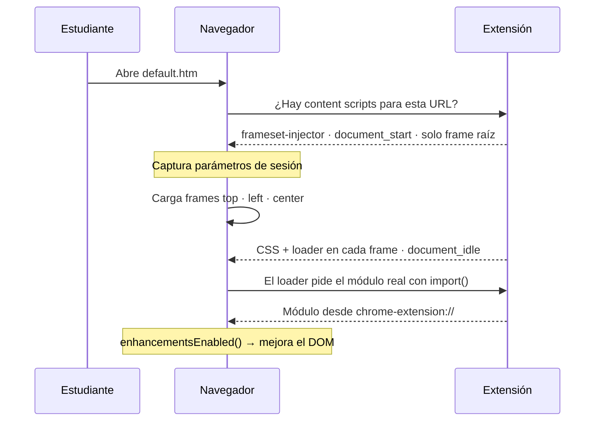
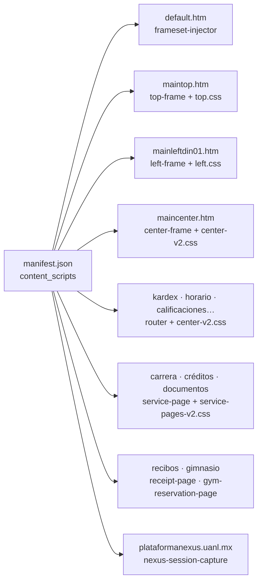
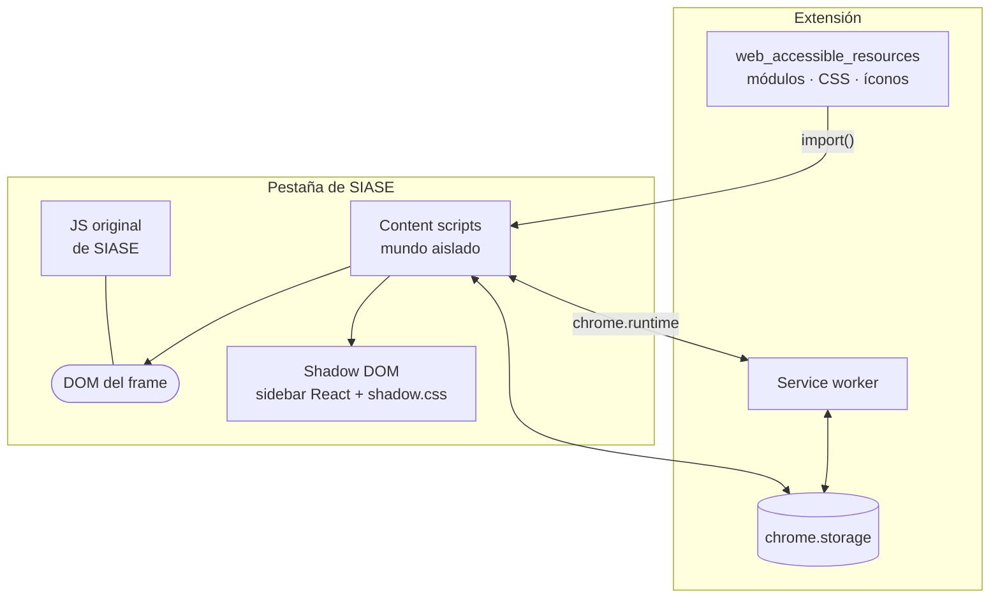

# Cómo se inyecta la extensión

Tres vistas de cómo el código de Oh My SIASE llega al navegador y se monta sobre el portal. Basadas en `manifest.json` y en el build de CRXJS (`dist/`).

## 1. Secuencia de carga

Qué pasa desde que el estudiante abre SIASE hasta que ve la interfaz nueva.

## 2. Del manifest a cada frame

Qué script y qué CSS se inyecta según la URL que carga cada frame.

## 3. Dónde vive cada pieza

Los contextos del navegador y cómo se comunican.

