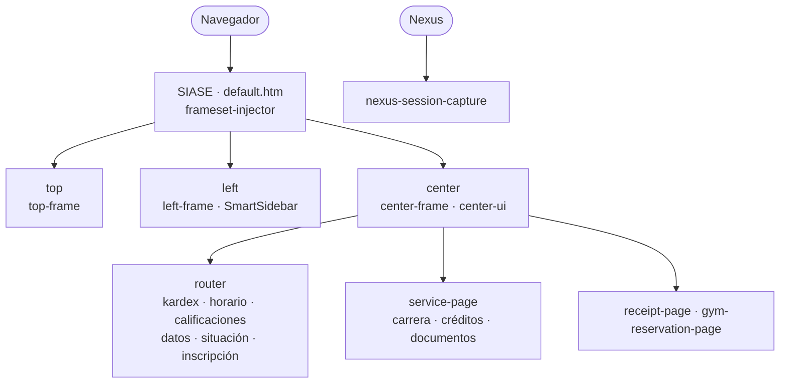
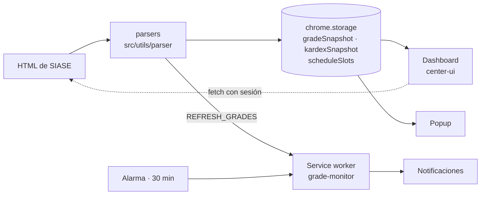
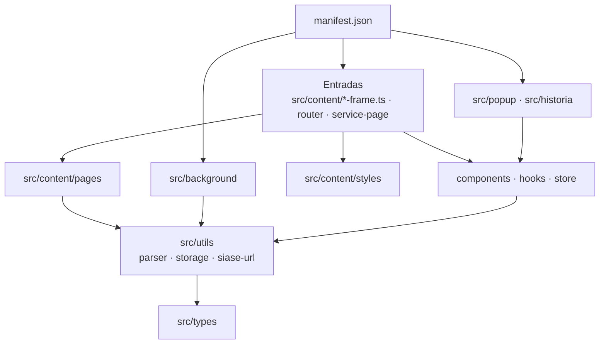

# Arquitectura

Tres vistas de cómo funciona Oh My SIASE. Solo incluyen código activo (registrado en `manifest.json` o importado por un script activo).

## 1. Dónde se inyecta

Qué script corre en cada parte del portal SIASE.

## 2. Cómo fluyen los datos

Del HTML de SIASE a lo que ve el estudiante.

## 3. Cómo está organizado el código

Capas del repositorio, de la configuración a los tipos.

